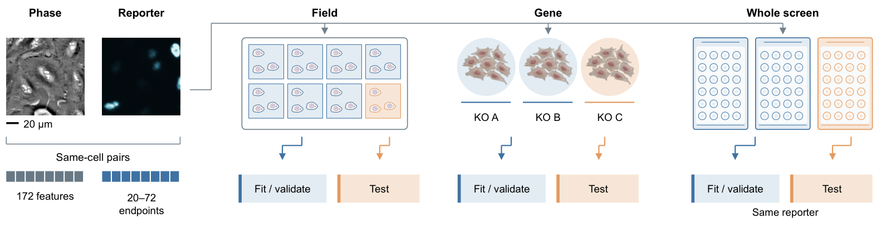
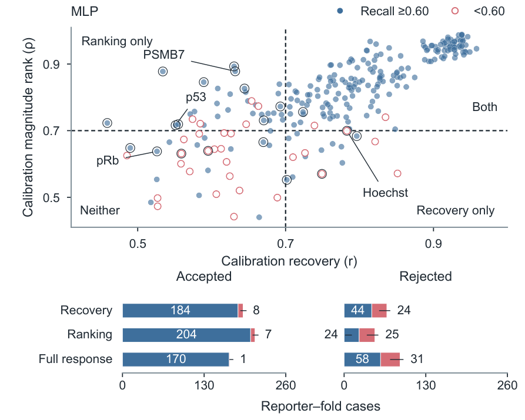
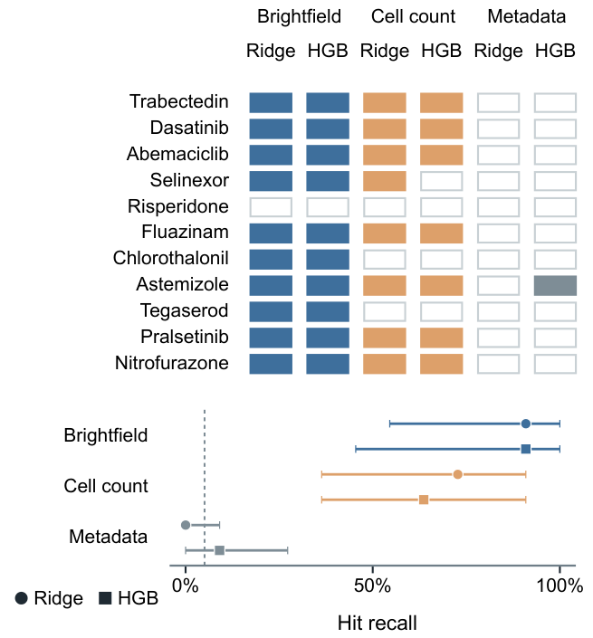
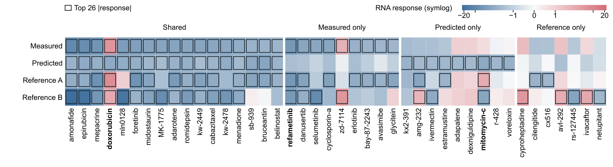

<a id="top"></a>

<div align="center">

<h1>MorphoSuff</h1>
<h3>Measurement sufficiency for cellular phenotypes</h3>

<p><b>What can a predicted measurement support?</b><br>
A Python toolkit for connecting morphology-based prediction to scientific use.</p>

<p>
  <a href="pyproject.toml"></a>
  <a href="LICENSE"></a>
  <a href="paper/manuscript.pdf"></a>
  <a href="https://doi.org/10.64898/2026.09.22.753654"></a>
  <a href="https://huggingface.co/datasets/Amanda1998/MorphoSuff"></a>
</p>

<p>
  <a href="https://limengran98.github.io/MorphoSuff/"><b>Project page ↗</b></a> ·
  <a href="#quick-start"><b>Quick start</b></a> ·
  <a href="#your-data"><b>Use your data</b></a> ·
  <a href="#results"><b>Key results</b></a> ·
  <a href="#cross-dataset"><b>Across datasets</b></a> ·
  <a href="docs/README.md"><b>Documentation</b></a> ·
  <a href="#citation"><b>Cite</b></a>
</p>

</div>

**MorphoSuff** assesses whether a predicted cellular readout supports quantitative
response estimation, perturbation ranking or a specified downstream analysis.
It brings together **held-out prediction, target reproducibility and retained
scientific utility**, keeping the evidence behind each measurement decision
visible.

The central principle is to validate **what a prediction will be used for**:
replace measured responses with predicted responses, repeat the intended
analysis, and assess whether the required evidence survives. For prospective
use decisions, fix an acceptance rule on calibration perturbations and test
accepted uses on separate perturbations, recording failures and missed
opportunities alongside coverage.

Use it with a new paired dataset or predictions from your own model. Dataset
adapters describe the experiment; shared analysis functions evaluate the
predictions and the uses they support.

<p align="center">
  <a href="paper/figures/Figure2.pdf"></a>
  <br>
  <sub>Prediction and generalization in the OPS study · <a href="paper/figures/Figure2.pdf">Figure 2a ↗</a></sub>
</p>

### From prediction to measurement decisions

| Generalization | Reference reliability | Scientific use |
| :--- | :--- | :--- |
| Does prediction recover responses to unseen perturbations or in a new screen? | Are the targeted responses reproducible across the relevant measurement replicates? | Are response magnitudes, candidate hits or functional conclusions retained? |

The assessment returns target-level evidence and decisions for the declared
**predictor, experimental context and intended use**.

<a id="installation"></a>
<a id="quick-start"></a>

## 🚀 Quick start

**Python 3.10+.** Install the package with its built-in tabular predictors and
Parquet support:

```bash
git clone https://github.com/limengran98/MorphoSuff.git
cd MorphoSuff
python -m pip install -e ".[sklearn,parquet]"
measurement-sufficiency --version
```

### Assess your evidence table

Prepare `evidence.csv` with one row per target and context. Required columns
are `reporter_id`, `recoverability_r`, `magnitude_spearman`, `variance_ratio`,
`top5pct_recall` and `reliability`; the [dataset guide](docs/adapt_new_dataset.md#5-assemble-evidence-and-assign-a-measurement-tier)
explains how to calculate them from held-out predictions and replicate measurements.

```python
import pandas as pd
from measurement_sufficiency.analysis.tiers import tier_table

evidence = pd.read_csv("evidence.csv")

decisions = tier_table(
    evidence, group_columns=["reporter_id"], aggregate="none"
)
print(decisions["tier"].value_counts())
decisions.to_csv("measurement_tiers.csv", index=False)
```

The API applies the study's reference operating points. Define criteria for
your intended use before the final evaluation; the guide also explains how
to supply context-specific thresholds.

<details>
<summary><b>Environment setup and optional dependencies</b></summary>

For an isolated environment, run `python -m venv .venv`, activate it with
`source .venv/bin/activate` (Windows PowerShell: `.venv\Scripts\Activate.ps1`),
then run the installation command above.

| Workflow | Installation |
| :--- | :--- |
| Built-in Ridge, gradient boosting and MLP | `python -m pip install -e ".[sklearn]"` |
| External tabular examples and Parquet files | `python -m pip install -e ".[sklearn,parquet]"` |
| CatBoost predictors | `python -m pip install -e ".[catboost]"` |
| PyTorch predictors | `python -m pip install -e ".[torch]"` |
| Tabular model-suite dependencies | `python -m pip install -e ".[models]"` |
| Raw-image study workflows | `python -m pip install -e ".[image]"` |

Study-specific model packages and upstream weights are documented
with their [adapters](docs/model_adapters.md),
[runners](docs/external_model_runners.md) and [data guide](docs/data_code_availability.md).

</details>

<a id="your-data"></a>

## Use MorphoSuff with your data

Choose the targeted readout, the scientific use and the unit to hold out.
Pairing may be at the cell or well level; reliability follows the experiment's
replicate structure.

| Starting point | Workflow |
| :--- | :--- |
| **Paired measurements** | Prepare observation metadata, input features and measured targets; define the split and fit a predictor. |
| **Your model's predictions** | Import measured and held-out predicted values with target, perturbation, screen and fold identifiers. |
| **An evidence table** | Supply recovery, magnitude ranking, variance ratio, hit recall and target reliability to the decision function. |

**[Prepare your dataset →](docs/adapt_new_dataset.md)** &nbsp;·&nbsp;
[Prediction schema](docs/adapt_new_dataset.md#3-fit-on-a-declared-split-or-import-predictions) &nbsp;·&nbsp;
[Model adapters](docs/model_adapters.md)

For a prediction table that includes matched controls, compute response fidelity
with the Python API:

```python
import pandas as pd
from measurement_sufficiency.analysis.response_fidelity import response_fidelity

predictions = pd.read_csv("predictions_fold0.csv")
fidelity = response_fidelity(predictions)

for name, table in fidelity.items():
    table.to_csv(f"fidelity_{name}.csv", index=False)
```

The output includes control-relative responses, response-magnitude ranks,
predicted-to-observed variance and strong-hit recall. Retain control predictions
within each evaluated screen and fold, and put target endpoints on a suitable
common scale. Add reliability from the relevant replicate measurements to
[assemble the decision evidence](docs/adapt_new_dataset.md#5-assemble-evidence-and-assign-a-measurement-tier).

<details>
<summary><b>Fit a reference predictor from your CSV tables</b></summary>

Prepare the [three input tables](docs/adapt_new_dataset.md#2-prepare-the-input-tables),
then run:

```bash
# Hold out perturbations and retain controls for response analysis.
measurement-sufficiency split gene observations.csv gene_split.csv \
  --folds 5 --seed 0 --control-column is_control

# Fit a Ridge predictor and export one held-out fold.
measurement-sufficiency run-fold \
  --inputs inputs.csv --targets targets.csv \
  --assignments gene_split.csv --split-name gene --fold 0 \
  --model ridge --features feature_001,feature_002 \
  --output predictions_fold0.csv

measurement-sufficiency validate-predictions predictions_fold0.csv
```

Replace the feature names and repeat `run-fold` for the remaining folds.
`gene` is the CLI name for a split by `perturbation_id`, including compounds.
The built-in fitting command supports `ridge`, `gbdt` and `mlp`; other
predictors can use the model adapters or export the same prediction schema.
See the [complete assessment workflow](docs/adapt_new_dataset.md#4-measure-prediction-and-response-fidelity)
for pooling, reliability estimation and decision criteria.

</details>

<a id="results"></a>

## 🔬 Selected results

### Test the use, not only prediction accuracy

Across 260 OPS reporter–fold cases, acceptance based on calibration response
ranking supported **204 successful prioritization uses**, compared with **184**
for acceptance based on Pearson recovery. These rules supported **7 and 8
failures**, respectively, on separate evaluation perturbations. Combining
response criteria supported 170 successes with one failure, at the cost of
missing more usable cases.

<p align="center">
  <a href="paper/figures/Figure3.pdf"></a>
  <br>
  <sub>Calibration evidence and held-out use decisions · <a href="paper/figures/Figure3.pdf">Figure 3e ↗</a></sub>
</p>

The task selects the strongest 20% of responses and requires hit recall of
at least 0.60. This comparison makes the trade-off between supported uses,
failures and missed opportunities explicit.

The complementary atlas assessment assigns five measurement tiers to a
fixed consensus predictor, using response fidelity and reference reliability:

| Decision | OPS reporters | Meaning under the reference rule |
| :--- | ---: | :--- |
| `quantitative_proxy` | 30 | Meets the declared response-recovery, ranking, amplitude-variance and hit-recall criteria |
| `ranking_proxy` | 7 | Preserves ranking and hit recall without meeting every quantitative criterion |
| `measurement_required` | 3 | Reliable reference measurements show insufficient recovery in the evaluated setup |
| `not_identifiable` | 9 | Reference reliability is below the study's operating point |
| `unresolved` | 3 | Available evidence does not establish one of the other outcomes |

These cut-offs are reference operating points for the study. For a new
application, specify acceptance criteria from the intended decision and
relevant repeat measurements. Downstream hit or functional-analysis retention
is evaluated alongside response fidelity.

### Prioritize strong metabolic loss in primary hepatocytes

A brightfield-based Ridge predictor recovered **10 of the 11 largest measured
metabolic-activity losses among 217 held-out compounds**, selecting only 11
compounds for follow-up. Training used paired data from 868 other compounds;
all doses and sources of each test compound were held out.

<p align="center">
  <a href="paper/figures/Figure6.pdf"></a>
  <br>
  <sub>Strong metabolic-loss prioritization · <a href="paper/figures/Figure6.pdf">Figure 6b ↗</a></sub>
</p>

The matched Ridge model using fluorescence-derived cell counts recovered
**8 of 11**. The score is signed metabolic-activity loss relative to
plate-matched controls, averaged over eight concentrations. This focused use
complements response-fidelity assessment by checking the selection decision
itself.

<a id="cross-dataset"></a>

## One assessment workflow, different measurement settings

The study applies the shared analysis logic to five resources. Each uses
its own fitted predictors, pairing and replicate definitions.

| Resource | Biological system | Input → targeted readout | Pairing unit |
| :--- | :--- | :--- | :--- |
| **OPS** | A549 cells | Phase morphology → 52 reporters | Cell |
| **OASIS** | Primary human hepatocytes | Brightfield morphology → metabolic activity and LDH release | Well |
| **PERISCOPE** | A549 cells | Four Cell Painting channels → anti-TOMM20 features | Cell; also evaluated as guide profiles |
| **Cell Health** | ES2 and HCC44 cells | Cell Painting → ten cell-health endpoints | Matched guides and cell context |
| **LINCS** | A549 cells | Cell Painting → 978 landmark RNA probes | Matched compound conditions |

This separation of dataset preparation from assessment lets you evaluate a
new cell system or assay through the same evidence tables, with the input
modality and experimental design made explicit.

**[OASIS and PERISCOPE workflows →](studies/external/README.md)** &nbsp;·&nbsp;
[Adapt a new dataset →](docs/adapt_new_dataset.md)

### Correlation and usefulness can diverge in either direction

In Cell Health, ES2 S-phase predictions retained **3 of 4** strongest responses
at Pearson **r = 0.604**, whereas late-apoptosis predictions retained **2 of 4**
at **r = 0.950**. In LINCS, BRCA1 predictions retained **17 of 26** strong-response
compounds at **r = 0.515**; comparisons against two separately acquired RNA
references each retained 17 of 26.

<p align="center">
  <a href="paper/figures/Figure6.pdf"></a>
  <br>
  <sub>A task-specific RNA prioritization example · <a href="paper/figures/Figure6.pdf">Figure 6f ↗</a></sub>
</p>

Across the complete LINCS probe panel, calibration-based task acceptance
also supported failures. The assessment therefore reports both an individual
target's useful task and how consistently a rule identifies useful targets
across the panel.

<a id="reproduce"></a>

## Documentation and reproducibility

| Goal | Entry point |
| :--- | :--- |
| **Use your own data** | [Dataset guide](docs/adapt_new_dataset.md) · [Model adapters](docs/model_adapters.md) |
| **Obtain the study data** | [Hugging Face release](https://huggingface.co/datasets/Amanda1998/MorphoSuff) · [Data access and contents](docs/data_code_availability.md) |
| **Run external workflows** | [OASIS and PERISCOPE](studies/external/README.md) |
| **Reproduce the OPS analyses** | [Protocols](docs/ops_protocols.md) · [Data preparation](docs/ops_data_and_preparation.md) · [Model runners](studies/ops/runners/README.md) |
| **Read the study** | [Manuscript](paper/manuscript.pdf) · [Supplementary Information](paper/supplementary.pdf) · [Figure PDFs](paper/figures/) |
| **Explore the package** | [Documentation index](docs/README.md) · [Contributing](CONTRIBUTING.md) |

<details>
<summary><b>Repository layout</b></summary>

```text
src/measurement_sufficiency/   Reusable Python package
studies/                      Dataset-specific preparation and analysis
configs/                      Model, split and analysis settings
docs/                         Usage guides and selected figure previews
reproducibility/               Data manifests and provenance tools
paper/                        Manuscript, Supplementary Information and figure PDFs
```

The [companion data release](release/huggingface/README.md) provides processed
OPS training arrays, exact-linked targets and frozen field/gene assignments.
Supplementary Data 1–3, including frozen predictions and result-verification
scripts, accompany the manuscript submission separately.

</details>

<a id="citation"></a>

## Citation and support

MorphoSuff accompanies **[When label-free morphology is sufficient for targeted
cellular measurements](https://doi.org/10.64898/2026.09.22.753654)**. Please cite
the bioRxiv preprint when using the framework:

```bibtex
@article{li2026morphosuff,
  title = {When label-free morphology is sufficient for targeted cellular measurements},
  author = {Li, Mengran and Zhu, Jianqing and Li, Bo and Zhang, Chengyang and Tang, Zhenchao and Wang, Jiaying and Xing, Wenbin and Zhang, Boyu and Xu, Jinfeng and Meng, Lingbei and Zhang, Bob and Chen, Junzhou and Zhang, Ronghui and Zhang, Lian and Xu, Jinchao},
  journal = {bioRxiv},
  year = {2026},
  doi = {10.64898/2026.09.22.753654},
  url = {https://doi.org/10.64898/2026.09.22.753654}
}
```

[CITATION.cff](CITATION.cff) provides separate software citation metadata. Cite
the original datasets and external predictors used in your analysis as well.

Study-owned code is released under the [MIT License](LICENSE). Source datasets
and third-party software retain their respective terms;
see [third-party notices](THIRD_PARTY_NOTICES.md).

For questions or reproducible bug reports, [open an issue](https://github.com/limengran98/MorphoSuff/issues)
with the package version, input schema and a minimal example.

---

<p align="center">
  <b>From prediction accuracy to scientific use.</b><br>
  <sub><a href="#top">Back to top ↑</a></sub>
</p>
